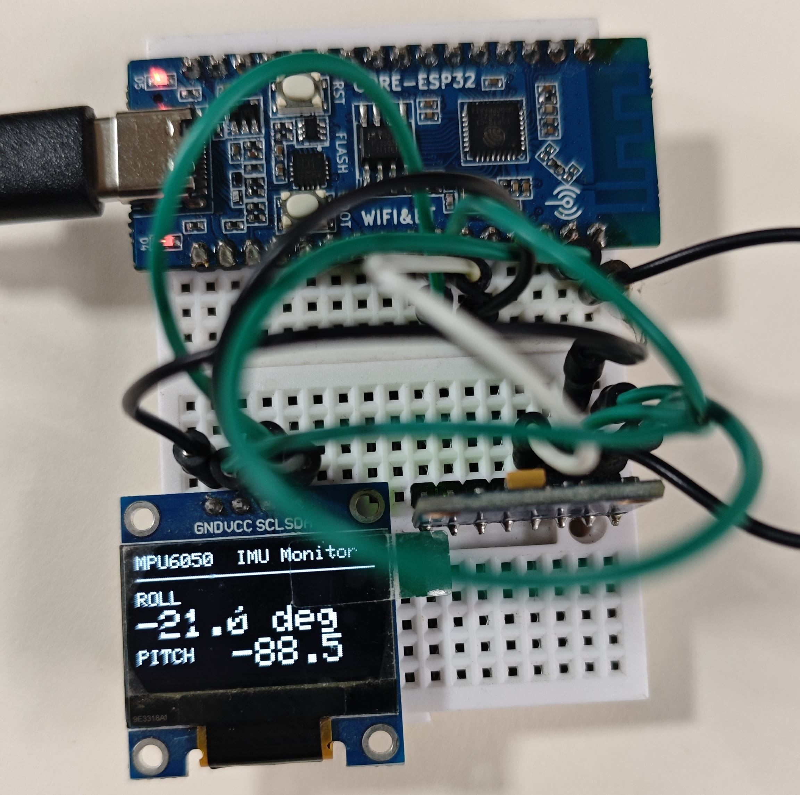

# ESP32-C3 + MPU6050 姿态显示

基于 **ESP32-C3** 和 **MPU6050** 的实时姿态角（Roll / Pitch）采集与显示小项目。
MPU6050 通过 I2C 输出加速度与陀螺仪原始数据，固件用**互补滤波**融合两者，
算出稳定的倾角后显示在 0.96 寸 SSD1306 OLED 上，同时从串口输出。



## 功能

- 启动时校验 MPU6050 的 `WHO_AM_I`，芯片无应答时在 OLED 与串口给出明确错误并停机
- 内部采样率 100 Hz（`SMPLRT_DIV = 9`），开启 DLPF 低通（加速度 44 Hz / 陀螺仪 42 Hz）
- 上电自动进行约 5 秒陀螺仪零偏校准（期间保持静止）
- 互补滤波融合：`angle = α × (angle + gyro·dt) + (1-α) × angle_acc`，α = 0.98
- OLED 每 200 ms 刷新一次 Roll / Pitch（单位：度）
- 串口 115200 同步打印 `Roll: xx.xx | Pitch: xx.xx`

## 硬件清单

| 器件 | 说明 |
| --- | --- |
| ESP32-C3 开发板 | 本仓库按 `esp32-c3-devkitm-1` 配置，SuperMini 等 C3 板同样可用 |
| MPU6050 模块 | 六轴陀螺仪加速度计，I2C 地址 `0x68`（AD0 接地） |
| SSD1306 OLED | 0.96 寸 128×64，I2C 地址 `0x3C` |
| 面包板 + 杜邦线 | — |

## 接线

两个模块都挂在同一条 I2C 总线上：

| 信号 | ESP32-C3 | MPU6050 | OLED |
| --- | --- | --- | --- |
| SDA | GPIO6 | SDA | SDA |
| SCL | GPIO7 | SCL | SCL |
| 电源 | 3V3 | VCC | VCC |
| 地 | GND | GND | GND |

> MPU6050 的 **AD0 引脚接地**（地址 0x68）；悬空/接高会变成 0x69，需要同步修改
> `MPU_ADDR`。OLED 一般为 0x3C，个别模块为 0x3D。

推荐 3.3V 供电：MPU6050 与 OLED 都支持 3.3V，直接与 ESP32-C3 电平匹配。

## 编译与烧录

需要 [PlatformIO](https://platformio.org/)（VS Code 插件或 CLI）。

```bash
# 编译
pio run

# 编译并烧录
pio run -t upload

# 查看串口输出
pio device monitor -b 115200
```

依赖库由 `platformio.ini` 的 `lib_deps` 自动安装：

- `adafruit/Adafruit GFX Library`
- `adafruit/Adafruit SSD1306`（会自动带上 Adafruit BusIO）

## 目录结构

```
.
├── platformio.ini        # 板卡、框架、库依赖配置
├── src/main.cpp          # 全部固件逻辑
├── include/              # 预留的头文件目录
├── lib/                  # 预留的私有库目录
├── test/                 # 预留的单元测试目录
└── docs/images/real.jpg  # 实物效果图
```

## 关键参数（`src/main.cpp`）

| 宏 / 常量 | 默认值 | 含义 |
| --- | --- | --- |
| `SDA_PIN` / `SCL_PIN` | 6 / 7 | I2C 引脚 |
| `MPU_ADDR` | 0x68 | MPU6050 地址 |
| `OLED_ADDR` | 0x3C | SSD1306 地址 |
| `ACC_SCALE` | 16384.0 | ±2 g 量程（16384 LSB/g） |
| `GYRO_SCALE` | 131.0 | ±250 °/s 量程（131 LSB/(°/s)） |
| `ALPHA` | 0.98 | 互补滤波系数，越大越信任陀螺仪 |
| `DLPF_CFG` | 0x03 | 低通滤波档位，加速度 44 Hz / 陀螺仪 42 Hz |
| `SAMPLE_RATE_DIV` | 0x09 | 1 kHz 分频到 100 Hz 内部采样率 |
| 采样周期 | 10 ms | 约 100 Hz |
| 刷新周期 | 200 ms | OLED 与串口输出 |

若要换成 ±4 g / ±500 °/s 等量程，需同时修改 `initMPU6050()` 里写入的 `GYRO_CONFIG`(0x1B) /
`ACCEL_CONFIG`(0x1C) 量程位以及对应的 `ACC_SCALE` / `GYRO_SCALE`。`DLPF_CFG` 越大滤波越强、
延迟越高（0 = 关闭，1~6 见数据手册）。

## 常见问题

- **OLED 显示 `OLED initialization failed!` 后卡住**：检查地址是否为 0x3C、SDA/SCL 是否接反、供电是否正常。
- **OLED 显示 `MPU6050 ERROR` 并停机**：`WHO_AM_I` 读不到，芯片没有应答。串口会打印扫描到的 I2C 地址，
  据此确认 AD0 是否接地（0x68）、供电与上拉是否正常。
- **角度一直是 0.00**：MPU6050 中途掉线，读数全部失败。检查接线/供电后重新上电。
- **串口提示 `too many failed samples`**：校准期间读取成功率偏低，检查接线/供电，或重新上电并保持静止。
- **静置时角度缓慢漂移**：上电时没有保持静止导致零偏校准不准，重新上电并静置即可；也说明 `ALPHA` 偏大，可略微调小。
- **数值抖动明显**：DLPF 已默认开启 44 Hz。仍抖可减小 `ALPHA`，或把 `DLPF_CFG` 调到 4~6（更强滤波、更大延迟）。
- **串口没有输出**：确认 `monitor_speed = 115200` 与 USB 数据线（而非仅充电线）正常。

## 限制

- 只输出 Roll / Pitch；Yaw 无磁力计参考，会随时间漂移，未做输出。
- 互补滤波在剧烈运动时会有瞬时误差，仅适合慢速倾斜检测、水平仪一类的应用。
